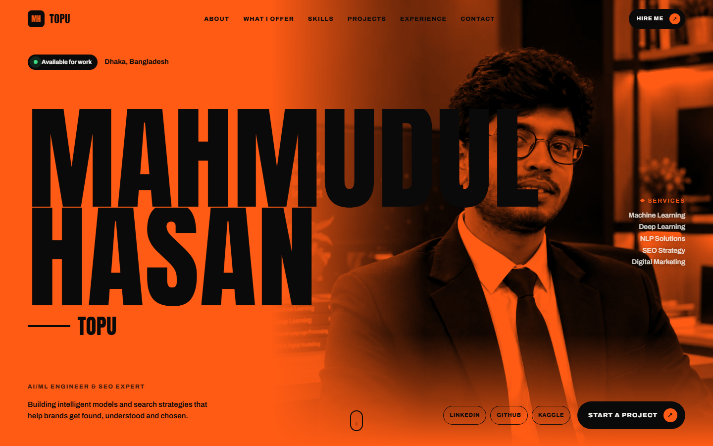
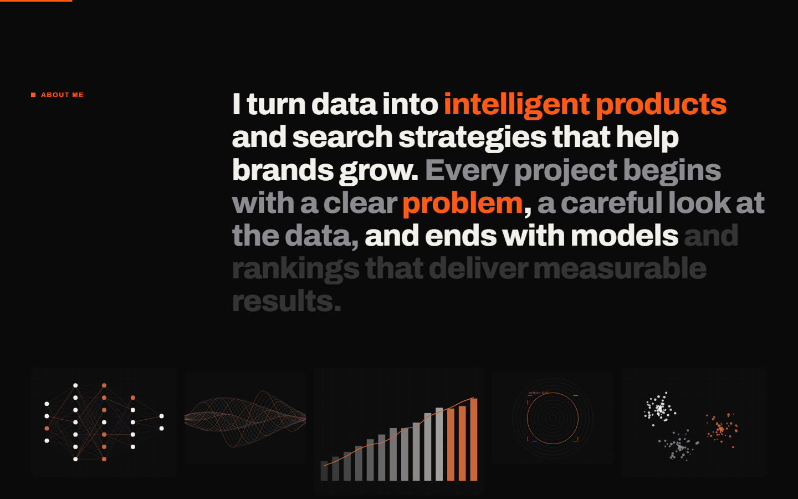
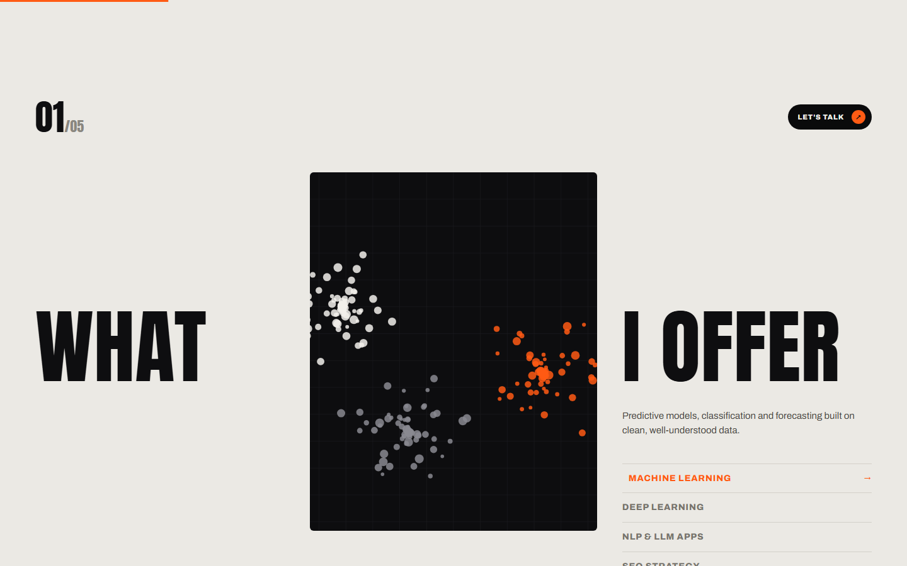
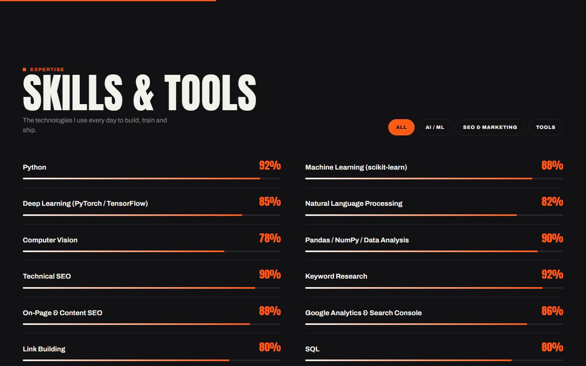
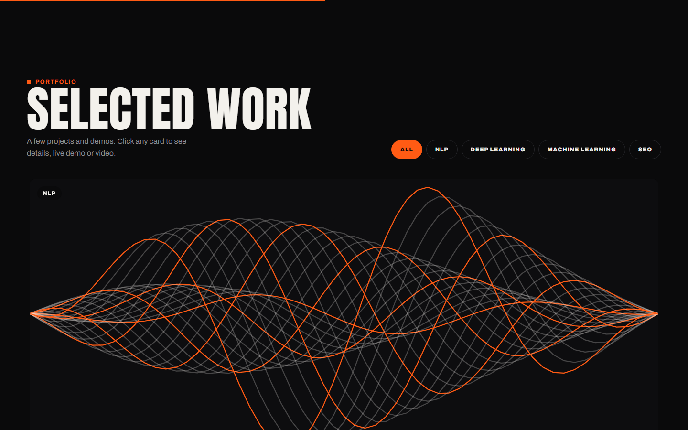
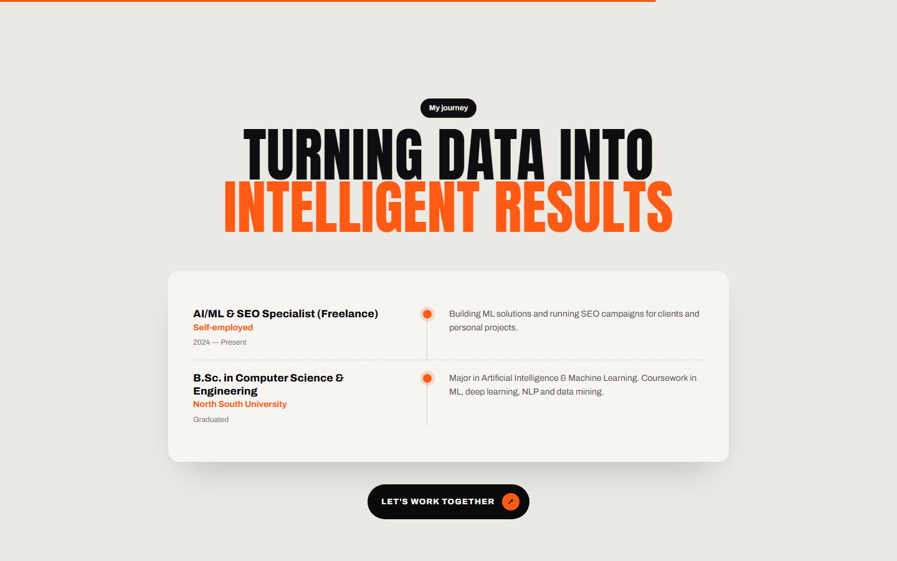
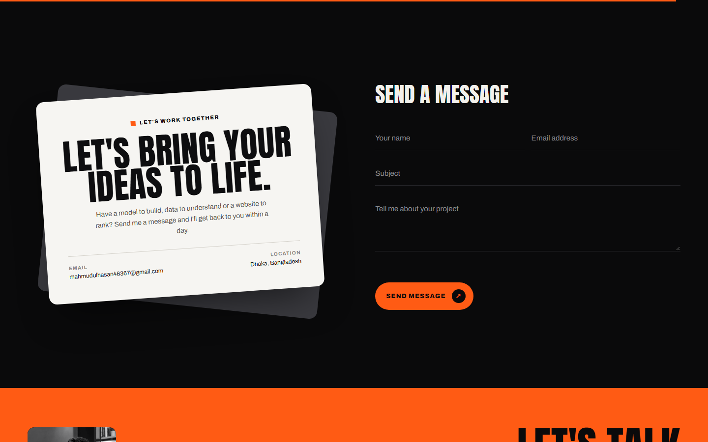
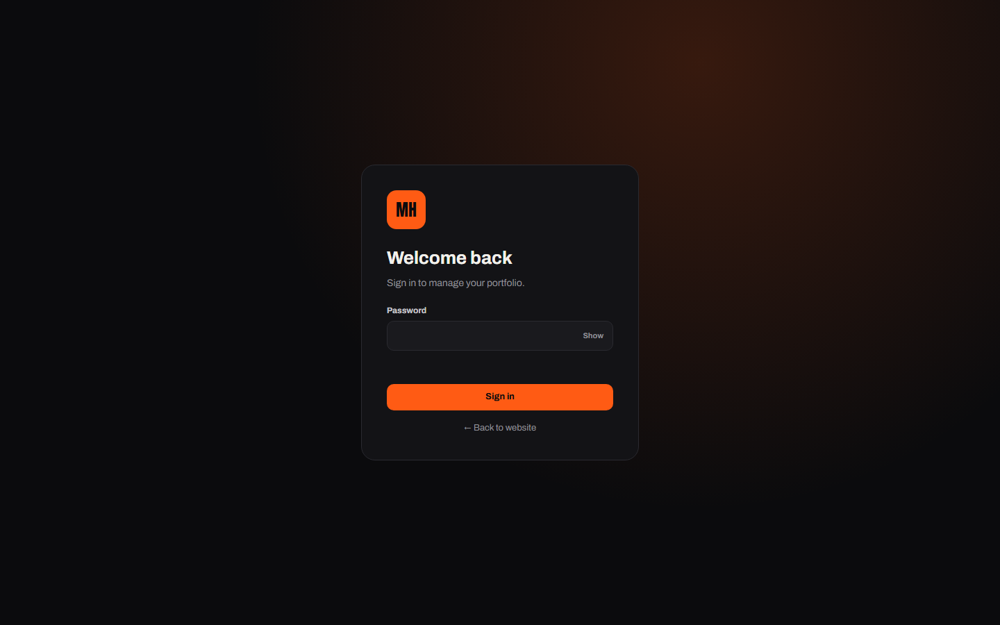
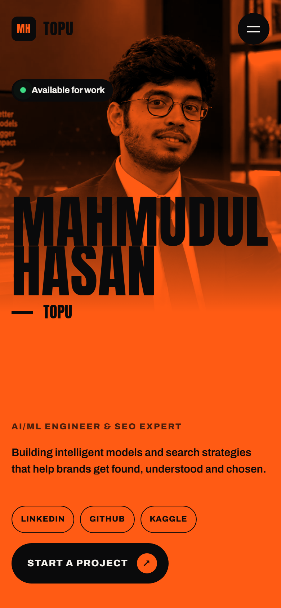

<div align="center">

<a href="https://newportfolio-wine-zeta.vercel.app">
  
</a>

<br>
<br>

[](https://newportfolio-wine-zeta.vercel.app)


[](LICENSE)

**The personal portfolio of Mahmudul Hasan Topu, AI/ML engineer and SEO expert.**<br>
A bold, animated one-page site with a built-in admin panel, so every word, photo, skill and project can be edited from the browser.

[Features](#features) · [Screenshots](#screenshots) · [Admin panel](#admin-panel) · [Run locally](#run-locally) · [Deploy](#deploy) · [Security](#security)

</div>

<br>

## Features

<table>
  <tr>
    <td width="50%" valign="top">
      <h4>🎨 Striking design</h4>
      Oversized type, an orange duotone hero photo, animated section reveals, a scroll-reactive marquee and magnetic buttons.
    </td>
    <td width="50%" valign="top">
      <h4>🛠️ Edit everything in the browser</h4>
      A private admin panel controls every section: text, photos, skills, projects, experience, certifications and contact details.
    </td>
  </tr>
  <tr>
    <td valign="top">
      <h4>🎬 Projects with demos</h4>
      Project cards with cover art, filters by category, and a detail view with live links, code links, screenshots and demo videos.
    </td>
    <td valign="top">
      <h4>🔍 Built for search</h4>
      Editable page title, description and keywords with a Google preview, plus a generated <code>sitemap.xml</code> and <code>robots.txt</code>.
    </td>
  </tr>
  <tr>
    <td valign="top">
      <h4>🔒 Secure admin</h4>
      Strong hashed passwords, optional two-factor login with backup codes, login lockouts, strict security headers and safe uploads.
    </td>
    <td valign="top">
      <h4>📱 Works everywhere</h4>
      Responsive layout for phones, tablets and desktops, and it respects the system's reduced-motion setting.
    </td>
  </tr>
</table>

## Screenshots

<p align="center">
  
  <br>
  <sub><b>About.</b> A short statement with highlighted keywords and animated illustrations.</sub>
</p>

<table>
  <tr>
    <td width="50%" align="center" valign="top">
      
      <br><sub><b>What I offer</b></sub>
    </td>
    <td width="50%" align="center" valign="top">
      
      <br><sub><b>Skills & tools</b>, filterable by category</sub>
    </td>
  </tr>
  <tr>
    <td align="center" valign="top">
      
      <br><sub><b>Selected work</b>, with category filters</sub>
    </td>
    <td align="center" valign="top">
      
      <br><sub><b>Experience</b> timeline</sub>
    </td>
  </tr>
</table>

<table>
  <tr>
    <td width="62%" align="center" valign="top">
      
      <br><sub><b>Contact</b> card and message form</sub>
      <br><br>
      
      <br><sub><b>Admin panel</b> sign-in</sub>
    </td>
    <td width="24%" align="center" valign="top">
      
      <br><sub><b>On a phone</b></sub>
    </td>
  </tr>
</table>

## Admin panel

Open `/admin` and sign in to edit the site. Click **Preview** to see changes as you type, then press **Save** or <kbd>Ctrl</kbd> + <kbd>S</kbd> to publish them.

| Area | What you can do |
| :-- | :-- |
| Dashboard | See unread messages, counts and quick links |
| Profile & Socials | Name, role, email, phone, location, CV (PDF) and social links |
| Hero | Photo and photo style (orange duotone, black & white or natural colour), intro text, button, services list and the scrolling text band |
| Sections & Order | Show or hide any section, rename menu labels and change the section order |
| Content sections | About, What I Offer, How I Work, Skills, Projects, Experience, Certifications, Highlights, Testimonials and Contact. Add, duplicate, delete and drag to reorder items |
| Projects | Cover image, demo video (MP4 upload or YouTube/Vimeo link), live and code links, tags, extra screenshots and a "featured" layout |
| SEO & Appearance | Page title, meta description and keywords with a Google preview, accent colour, favicon, loading screen and cursor settings |
| Media Library | Upload (drag and drop works), browse, copy links to and delete images, videos and PDFs |
| Messages | Read contact form messages, reply by email, mark them read or unread and delete them |
| Security | Change the password, set up two-factor login, see active sessions and the security log |
| Backups & History | Restore any of the last 20 saved versions in one click, or download and restore a backup file |

**Text highlighting:** in statements, `*word*` turns a word orange and `~word~` turns it grey.

## Built with

- **HTML, CSS and plain JavaScript** on the front end, with no framework and no build step
- **[Express](https://expressjs.com/)** on Node.js for the site, the admin API and the contact form
- **[sharp](https://sharp.pixelplumbing.com/)** to resize uploaded photos, convert them to WebP and strip EXIF and GPS data
- **[Upstash Redis](https://upstash.com/)** and **[Vercel Blob](https://vercel.com/docs/storage/vercel-blob)** for content and uploads when hosted on Vercel, or plain JSON files and a folder when run locally

<details>
<summary><b>Project structure</b></summary>
<br>

```
newportfolio/
├── server.js               Express server: pages, admin API, auth, uploads, SEO routes
├── lib/
│   ├── store.js            Storage layer (Redis + Blob on Vercel, files locally)
│   └── totp.js             Two-factor login codes
├── views/index.html        Page shell for the public site
├── public/
│   ├── css/style.css       Site design and animation
│   ├── js/main.js          Renders the content and runs the interactions
│   ├── admin/              Admin panel (HTML, CSS, JS)
│   └── assets/             Profile photo, favicon and project cover art
├── data/content.json       All site content (used when running locally)
├── uploads/                Uploaded files (used when running locally)
├── docs/images/            README banner and screenshots
└── vercel.json             Vercel routing and security headers
```

</details>

## Run locally

You need [Node.js](https://nodejs.org/) 20 or newer.

```bash
git clone https://github.com/mahmudultopu/newportfolio.git
cd newportfolio
npm install
npm start
```

- Website: <http://localhost:3000>
- Admin panel: <http://localhost:3000/admin>

The first admin password is `admin123`, or the value of `ADMIN_PASSWORD` if you set it before the first start. On first sign-in you are taken to **Security**, and editing stays locked until you choose a strong password.

Use `npm run dev` to restart the server automatically when you change a file.

<details>
<summary><b>Where things are stored locally</b></summary>
<br>

| Path | Contents |
| :-- | :-- |
| `data/content.json` | All site content |
| `data/messages.json` | Contact form messages |
| `data/auth.json` | The hashed admin password and two-factor settings |
| `data/history/` | The last 20 saved versions |
| `data/security-log.json` | Sign-ins and security events |
| `uploads/` | Uploaded files |

Deleting `data/auth.json` resets the password to the default and turns off two-factor login. Only someone with access to the server's files can do this, so it is the way back in if you lose both your phone and your backup codes.

</details>

## Deploy

### Vercel

The live site runs on Vercel. Because Vercel does not keep files on disk, connect two storage services to the project:

1. **Upstash Redis** (from the Vercel Marketplace) for content, messages and sessions. It sets `KV_REST_API_URL` and `KV_REST_API_TOKEN`.
2. **Vercel Blob** for uploaded files. It sets `BLOB_READ_WRITE_TOKEN`.

Then deploy:

```bash
npx vercel deploy --prod
```

Pushing to `main` redeploys the site automatically when the project is connected to this repository.

### Other hosts

Any host that runs Node.js and keeps files on disk works too, such as a VPS, Render with a persistent disk, Railway or Hostinger's Node hosting.

| Variable | Purpose |
| :-- | :-- |
| `PORT` | Port to listen on (default `3000`) |
| `ADMIN_PASSWORD` | Initial admin password, used before the first sign-in |
| `TRUST_PROXY` | Set to `1` behind a proxy (Render, Railway, Nginx, Cloudflare) so lockouts see real visitor IPs |
| `SITE_URL` | Your public address, for example `https://your-domain.com`, used for SEO links |

## Security

<details>
<summary><b>How the admin panel is protected</b></summary>
<br>

- Passwords are hashed with scrypt and must be strong: 10 or more characters, mixed character types, not a common password and not your name.
- Optional two-factor login (Google Authenticator, Authy and similar apps) with 8 one-time backup codes and protection against code reuse.
- After 5 wrong attempts an IP address is locked out, starting at 5 minutes and doubling each time up to 24 hours. Every failed attempt is logged.
- Sessions use HttpOnly, SameSite=Strict cookies that are Secure on HTTPS. They expire after 2 hours of inactivity and always after 12 hours. Changing the password signs out every other device.
- Every change must come from the admin page itself (custom header and Origin check), which stops cross-site request forgery.
- A strict Content Security Policy and other security headers protect against XSS, clickjacking and MIME sniffing.
- Uploads are checked by their real contents, not just the file name. Unsafe SVGs are rejected and uploaded files are served in a sandbox.
- The API and contact form are rate-limited. The contact form also has a honeypot and a time check against spam bots.

</details>

**When you put it online:** use HTTPS, turn on two-factor login in **Security**, keep the backup codes somewhere safe, and keep Node.js and dependencies up to date (`npm audit`, `npm update`).

## License

The code is released under the [MIT License](LICENSE). The personal content, including the profile photo, name, text and project details, is not covered by the license and may not be reused without permission.

<br>

<div align="center">
  <sub>Made by <a href="https://github.com/mahmudultopu">Mahmudul Hasan Topu</a>. If this project helps you, a ⭐ on the repository is appreciated.</sub>
</div>
